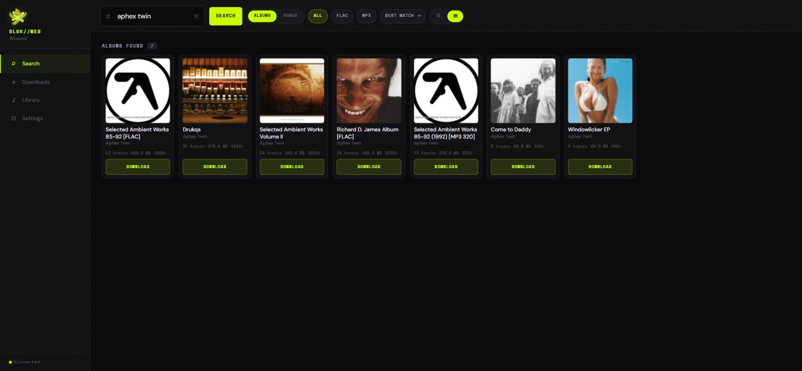
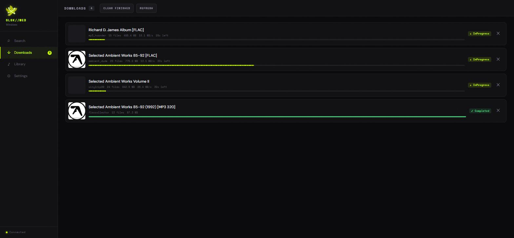
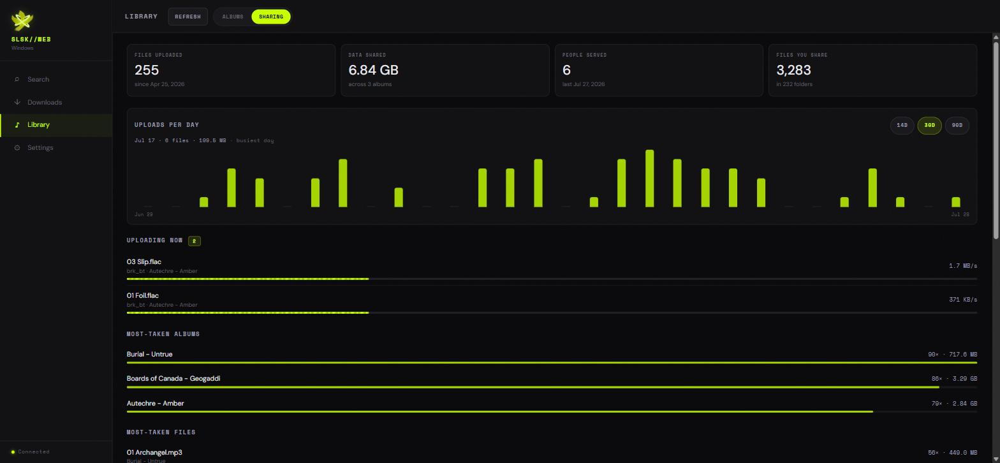
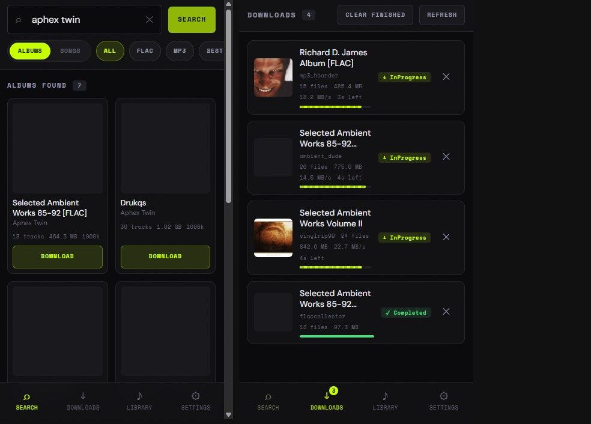

# soulseek-web

<p align="center">
  
</p>

<p align="center">
  A minimalist web UI for <a href="https://github.com/slskd/slskd">slskd</a> — search and download
  music from the Soulseek network in your browser, from any device, with no desktop client.
</p>

<p align="center">
  <a href="#installation"></a>
  <a href="LICENSE"></a>
  
</p>

---

## Screenshots

<p align="center">
  
  <br><em>Search results — grid and list view, ranked and de-duplicated</em>
</p>

<p align="center">
  
  <br><em>Downloads — grouped by album, with live progress, speed and ETA</em>
</p>

<p align="center">
  
  <br><em>Sharing — what others have taken from your library, over time</em>
</p>

<p align="center">
  
  <br><em>Mobile — bottom navigation, installable to the home screen</em>
</p>

---

## Features

**Finding music**
- 🔍 Search albums and songs across the Soulseek network
- 🏅 Smart ranking — real album popularity (Deezer), lossless first, bitrate, then peer availability
- 🧹 Automatic de-duplication of the same album from many peers, keeping the best copy
- ⚡ Advanced mode returns everything, unfiltered, for rare material
- 🎛️ Filter by format, sort by quality / size / tracks / peer speed
- 📈 Trending albums and recent searches on the empty state

**Getting it**
- ⬇️ One-click download of a whole album or individual tracks
- 📊 Live progress per album *and* per track, with transfer speed and ETA
- ✕ Cancel a single transfer, clear finished ones, or delete an album from queue and disk

**Listening**
- 🎵 Built-in player streams your downloads straight to the browser
- ⏯️ Lock-screen and headphone controls on phones (Media Session)
- 💾 Save any track from the server to the device you're browsing from
- 📚 Library view of everything already downloaded, with embedded cover art

**Sharing back**
- 📊 **Sharing stats** — how many files have been uploaded from your library, how much data, and to how many people
- 🏆 Which albums, files and users account for the most traffic, ranked
- 📅 Uploads per day over the last 14 / 30 / 90 days
- 📡 Live view of what people are pulling from you right now
- 💾 Counted and stored by soulseek-web, so the history survives slskd clearing its own transfer list

**Everywhere**
- 📱 Installable PWA — add to home screen, runs full-screen, works offline for browsing
- 🖼️ Cover art from embedded tags, folder images, or Deezer, cached on disk and in the browser
- 🌐 English and Spanish
- 🔒 Optional password protection
- 🔄 In-app update from the Settings panel

---

## Installation

### Option 1 — Docker (recommended)

Brings up slskd **and** soulseek-web, already wired together.

```bash
git clone https://github.com/sgutierrezbe/soulseek-web.git
cd soulseek-web
cp .env.example .env
$EDITOR .env          # Soulseek username + password, and any random API key
docker compose up -d
```

Open <http://localhost:8080>.

> **Forward the Soulseek port.** `SOULSEEK_LISTEN_PORT` (default `50300`) should be forwarded in
> your router. Without it you can only transfer with peers who can open the connection themselves,
> and downloads will queue far more often.

Already running slskd? Delete the `slskd` service from `docker-compose.yml` and point `SLSKD_URL`
at your instance.

> **Upgrading an existing 1.x install?** Follow [docs/UPGRADE-2.0.md](docs/UPGRADE-2.0.md) — a
> step-by-step runbook with verification checks and a rollback path. Your settings, slskd config
> and downloads are all preserved.

### Option 2 — Linux (systemd)

```bash
curl -sSL https://raw.githubusercontent.com/sgutierrezbe/soulseek-web/main/install.sh | sudo bash
```

Clones to `/opt/soulseek-web`, builds a virtualenv, and registers a service that starts on boot.
Open `http://<your-ip>:8080` — the setup wizard asks for your slskd URL and API key.

To update: re-run the command, or use the **Update** button in Settings.

### Option 3 — Windows (standalone)

No prerequisites. The script installs Python, Git and slskd for you.

```powershell
Set-ExecutionPolicy Bypass -Scope Process -Force; irm https://raw.githubusercontent.com/sgutierrezbe/soulseek-web/main/install.ps1 | iex
```

Creates a desktop shortcut and opens <http://localhost:8080>. Enter your Soulseek username and
password and you're done.

> No Soulseek account? Create one free at [slsknet.org](https://www.slsknet.org/).

### Option 4 — Manual

```bash
git clone https://github.com/sgutierrezbe/soulseek-web.git
cd soulseek-web
python3 -m venv venv
source venv/bin/activate          # Windows: venv\Scripts\activate
pip install -r requirements.txt
uvicorn main:app --host 0.0.0.0 --port 8080
```

---

## Configuration

The setup wizard covers everything on first launch, and Settings can change it later. Environment
variables override saved settings, which is what the Docker setup relies on.

| Variable | Default | Description |
|---|---|---|
| `SLSKD_URL` | `http://localhost:5030` | slskd base URL |
| `SLSKD_API_KEY` | *(none)* | slskd API key |
| `MUSIC_PATH` | `/mnt/music/downloads` | Where slskd saves downloads |
| `AUTH_PASSWORD` | *(none)* | Require this password to open the UI |
| `CONFIG_DIR` | app directory | Where `credentials.json` and the cover cache are written |
| `SESSION_SECRET` | generated | Signs session cookies; set to keep logins across restarts |

### Security

There is no login by default, which is the right default on a home LAN. **Set a password before
exposing this to the internet** — either `AUTH_PASSWORD`, or Settings → Security. With it set,
every API route requires a signed session cookie.

Note that soulseek-web holds your slskd API key and can delete files inside `MUSIC_PATH`. Put it
behind a reverse proxy with TLS if it leaves your network.

---

## Stack

- **Backend** — [FastAPI](https://fastapi.tiangolo.com/) + [httpx](https://www.python-httpx.org/), with a shared connection pool and a two-tier cover cache
- **Frontend** — [Alpine.js](https://alpinejs.dev/), self-hosted. No build step, no Node, no CDN
- **Audio metadata** — [Mutagen](https://mutagen.readthedocs.io/)

Everything the browser loads — Alpine, fonts, icons — is served from this app, so it works on an
air-gapped LAN and there are no third-party requests on page load.

## APIs & acknowledgements

- **[slskd](https://github.com/slskd/slskd)** — the Soulseek daemon doing the actual searching and transferring. Every network call goes through its REST API.
- **[Deezer](https://developers.deezer.com/)** — cover art and popularity ranking. Free, no key.
- **[iTunes RSS](https://rss.applemarketingtools.com/)** — the trending albums chart.
- **[Soulseek](https://www.slsknet.org/)** — the P2P network that has been running for 25 years, full of music you cannot find anywhere else.

---

## Development

```bash
pip install -r requirements.txt pytest
pytest                                        # 80 tests, no slskd needed
uvicorn main:app --reload --port 8080
```

`GET /api/docs` serves the OpenAPI browser. `GET /health` reports app and slskd status and backs
the Docker healthcheck.

Layout:

```
main.py          app wiring, static mounts, health
config.py        runtime settings (env > credentials.json > local_setup.json)
slskd.py         pooled async client for the slskd API
auth.py          optional password + session middleware
cache.py         TTL cache and the two-tier cover cache
paths.py         music-folder resolution; every path is confined to MUSIC_PATH
stats.py         durable upload tallies, sampled from slskd every 30s
routers/         search, downloads, library, covers, stream, stats, setup
static/          css, js, fonts, icons, service worker
```

---

## Notes

- Soulseek does not allow one account to be logged in from two places at once. Running this on a server *and* a local Windows install needs two accounts.
- The `.incomplete` folder inside your downloads directory is used by slskd for in-progress files, and is ignored when deciding whether a folder is empty.
- Deleting an album removes it from the queue and from disk. Paths are resolved and checked to be inside `MUSIC_PATH` first.

## Useful commands (Linux / systemd)

```bash
sudo systemctl status soulseek-web
sudo systemctl restart soulseek-web
sudo journalctl -u soulseek-web -f
```

## License

[MIT](LICENSE)
